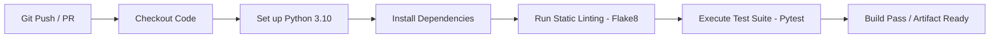

# MLOps Continuous Integration (CI) Pipeline

[](https://github.com/Akshay6441/CI_Pipeline/actions/workflows/python-app.yml)
[](https://www.python.org/)
[](https://flask.palletsprojects.com/)
[](https://scikit-learn.org/)
[](https://github.com/features/actions)

A production-style **Machine Learning CI/CD Pipeline** demonstrating automated code quality enforcement, dependency validation, regression model serving via Flask, and continuous integration workflows powered by **GitHub Actions**.

---

## 📌 Features

* **ML Model Serving:** RESTful Flask inference service serving predictions from trained Scikit-Learn regression pipelines.
* **Automated CI Workflow:** Triggered on every `push` and `pull_request` to `main`:
  * Python environment provisioning (Python 3.10).
  * Automated dependency caching and resolution.
  * Code linting & static analysis with `flake8`.
  * Unit and integration test validation with `pytest`.
* **Reproducibility:** Clean separation of model artifacts (`joblib`), runtime dependencies (`requirements.txt`), and application server logic.

---

## 📂 Project Structure

```tree
CI_Pipeline/
├── .github/
│   └── workflows/
│       └── python-app.yml       # GitHub Actions CI workflow configuration
├── app.py                       # Flask inference API & model prediction handler
├── requirements.txt             # Environment dependencies (scikit-learn, pandas, flask, etc.)
└── README.md                    # Project documentation & setup instructions
```

---

## ⚙️ Local Development & Setup

### 1. Clone & Set Up Virtual Environment

```bash
git clone https://github.com/Akshay6441/CI_Pipeline.git
cd CI_Pipeline

# Create and activate virtual environment
python -m venv .venv
source .venv/bin/activate  # On Windows: .venv\Scripts\activate

# Install dependencies
pip install -r requirements.txt
```

### 2. Run the Model Service

```bash
python app.py
```

The Flask server will start locally at `http://127.0.0.1:5000/`.

---

## 🧪 CI Workflow Details

The pipeline defined in `.github/workflows/python-app.yml` automates verification across commits:



---

## 👤 Author

* **Akshay** – [GitHub: @Akshay6441](https://github.com/Akshay6441)
